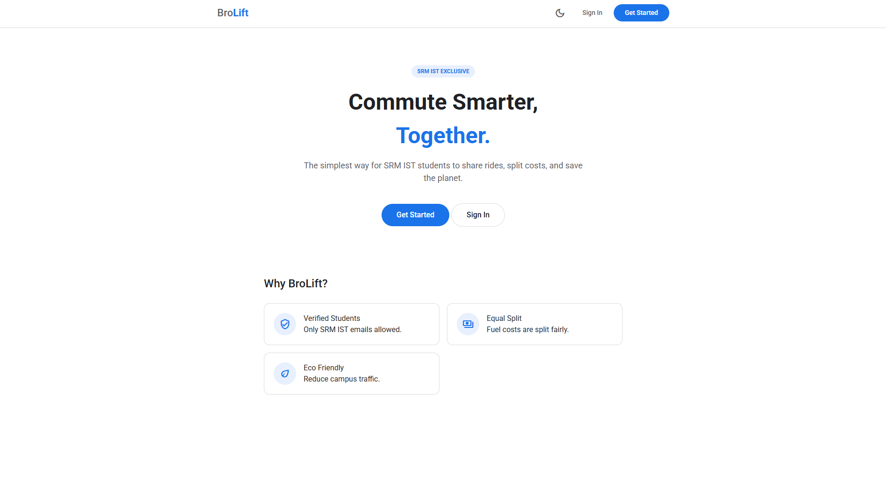
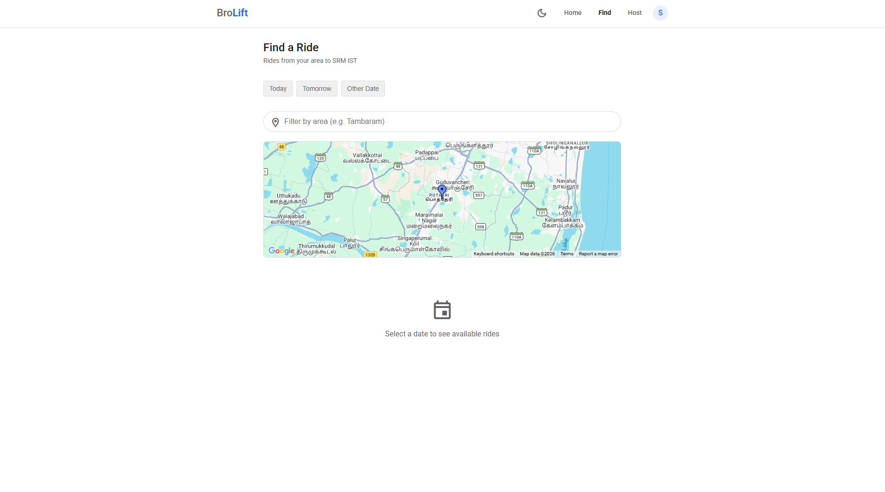
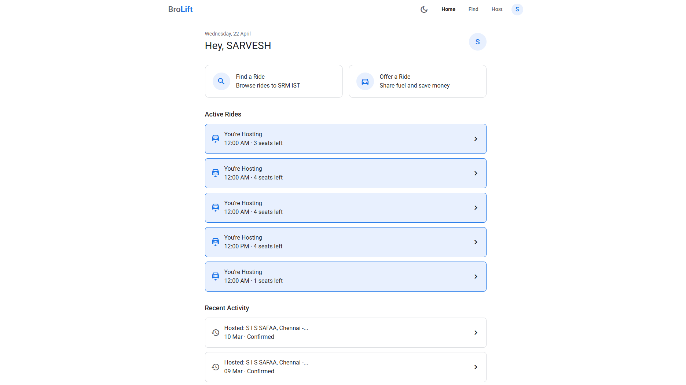
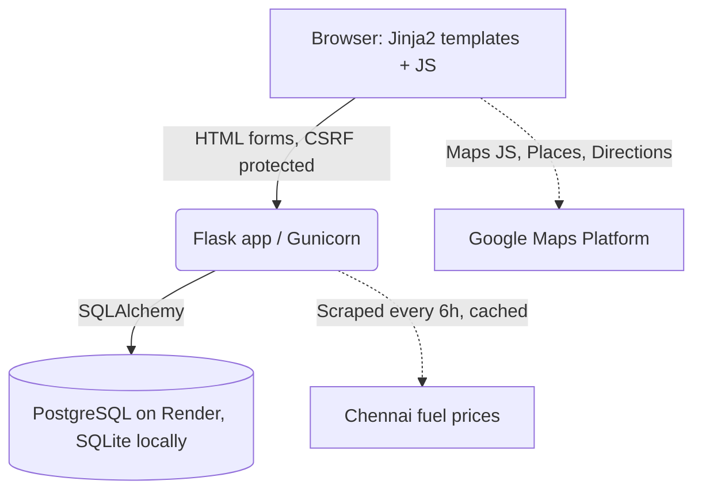

# BroLift: Carpooling for SRM IST Students

BroLift helps SRM IST (Kattankulathur) students share rides to and from campus. Students with a car or bike host rides; others find a ride, request a seat, and split the fuel cost fairly.

[](https://github.com/sarvesh-raam/BroLift/actions)
[](https://brolift.onrender.com)
[](https://opensource.org/licenses/MIT)

## Interface Preview

| Home Dashboard | Ride Search | Ride Management |
| :---: | :---: | :---: |
|  |  |  |

## Features
- **Campus-only sign-up**: registration is restricted to `@srmist.edu.in` addresses.
- **Host a ride**: pick a start point with Google Places, preview the route to campus, and choose seats, departure time, tolls and wait time.
- **Fair cost split**: fuel cost is estimated from route distance, vehicle mileage and live Chennai fuel prices, then split between the host and every offered seat.
- **Find a ride**: filter by date and time (±1 hour), see rides on a map, and send a join request with your pickup point.
- **Passenger preferences**: hosts can restrict a ride to girls only or boys only. The server enforces this.
- **Ride management**: hosts accept or decline requests, open the full pickup route in Google Maps, and mark rides completed or cancelled.
- **Ride chat**: the host and confirmed passengers can message each other.
- **Light and dark themes**, with a mobile-first layout and bottom navigation.

## Architecture



| Path | Purpose |
| --- | --- |
| `app/routes/auth.py` | Register, login, profile |
| `app/routes/rides.py` | Host, find, request, manage, chat, fuel-price API |
| `app/routes/dashboard.py` | Landing page and home dashboard |
| `app/utils/migrations.py` | Adds missing columns to existing databases on startup |
| `app/utils/fuel_prices.py` | Live fuel price scraper with fallback defaults |
| `tests/` | Pytest suite covering the main flows and access-control rules |

All times are stored and compared in IST (`app/utils/time.py`), even though the server runs in UTC.

## Running locally

```bash
python -m venv venv
source venv/bin/activate        # Windows: venv\Scripts\activate
pip install -r requirements.txt
cp .env.example .env            # then fill in GOOGLE_MAPS_API_KEY and SECRET_KEY
python run.py                   # http://localhost:5000
```

Without `DATABASE_URL`, the app uses a local SQLite file (`instance/brolift.db`).

Run the tests:

```bash
pip install pytest
pytest -q
```

## Deploying to Render

The repo includes a `render.yaml` blueprint.

1. **Create a database.** Use a Render PostgreSQL instance, or a free persistent one from [Neon](https://neon.tech) or [Supabase](https://supabase.com). Render's free PostgreSQL expires after 30 days, and the app stops working when it does.
2. **Create the web service.** Use *New → Blueprint* on this repo, or configure it manually:
   - Build command: `pip install -r requirements.txt`
   - Start command: `gunicorn run:app --workers 2 --threads 4 --timeout 60 --bind 0.0.0.0:$PORT`
   - Health check path: `/healthz`
3. **Set environment variables:**

   | Variable | Value |
   | --- | --- |
   | `DATABASE_URL` | Your PostgreSQL connection string (`postgres://` URLs are accepted) |
   | `SECRET_KEY` | A long random string. Keep it fixed, or every deploy logs everyone out |
   | `GOOGLE_MAPS_API_KEY` | A key with the Maps JavaScript, Places and Directions APIs enabled |

4. In Google Cloud Console, **restrict the Maps key** to your Render domain (HTTP referrer restriction). The key is visible in page source.

Tables are created automatically on first boot, and missing columns are added to older databases.

## License
Distributed under the MIT License.
